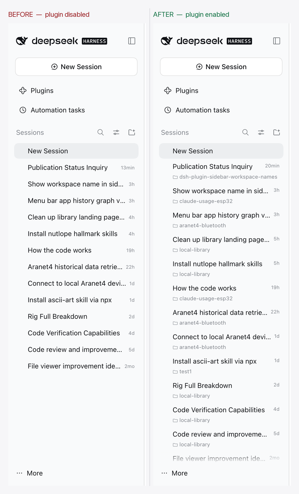

# Sidebar Workspace Names — DeepSeek Harness

**See which workspace a session belongs to, without leaving the sidebar's _In one list_ view.**

```text
┌──────────────────────────────────┐
│ Fix the sidebar labels        3h │
│ 📁 claude-usage-esp32            │
├──────────────────────────────────┤
│ Add the cost pill              2h │
│ 📁 focus-desk                    │
└──────────────────────────────────┘
```

The flat session list mixes sessions from every workspace, so a title alone does not
say where the session lives. This plugin puts the owning workspace on a second line
under the title, and keeps the full, untruncated name in the row's hover card.



## What you get

- **In one list** (`View options → Group by → In one list`) renders each session as a
  two-line row: title and relative time on top, the workspace name below.
- Sessions that belong to no registered workspace read **Ungrouped**.
- The automatic default workspace reads as a localized "Default workspace".
- **Grouped** and **Workspace Tree** views are unchanged — their workspace headers
  already name the workspace.
- Hovering a row shows the full workspace name in the hover card, even when the
  second line had to truncate a long name.

## Install

From npm:

```bash
dsh plugin --profile desktop add dsh-plugin-sidebar-workspace-names
```

You can also install it from the Plugins page in the desktop app. Restart the profile
and refresh the page once.

From a checkout instead (no build step, no dependencies):

```bash
git clone https://github.com/The-Focus-AI/dsh-plugin-sidebar-workspace-names
dsh plugin --profile desktop add ~/The-Focus-AI/dsh-plugin-sidebar-workspace-names
```

## How it works

It is an ordinary Cordis client plugin bundle — no harness source is patched, forked,
or monkey-patched:

- `sidebar.workspaces.session.row.action` hosts the workspace chip.
- `sidebar.session.row.hover` hosts the full name inside the hover card.
- A small stylesheet turns flat-view session rows into two-line rows and scopes every
  rule to the flat list, so grouped views keep their shipped 32px rows.

`client.js` ships as plain JavaScript on purpose: the harness injects client plugin
bundles into the page as a classic script, so the file reaches the JS engine verbatim.
There is no build step and no runtime type stripping in the browser.

## Known limits

- **Row DOM coupling.** The chip is placed relative to ui-workspace's session row
  (`[data-row-key="session:…"]`) and the always-mounted row action strip. That is a
  decoration contract, not a public API; `engines.dsh` pins the tested range, and a
  harness change should get a plugin version bump.
- **The strip's own controls are hidden while the chip shows.** Because the chip shares
  the strip with archive/pin, those buttons are suppressed on flat rows and come back on
  hover; a harness change to the strip's markup can strand them visible.
- **`:has()` is required** for the flat-view scoping (Chromium 105+, Safari 15.4+).
  Without it the chip simply stays hidden.
- **Fixed two-line height.** Workspace names longer than the line ellipsize; the hover
  card carries the full name. Rows are 48px tall in the flat view.
- **Blank New Session rows** have no action strip, so they keep the single-line height.
- **No visual test.** The suite covers name resolution only; the layout is CSS against
  another package's DOM.

## Development

```bash
mise trust
mise install
mise test          # node --test
npm pack --dry-run # verify the published file list
```

The package has no runtime dependencies and no build step.

## License

MIT — see [LICENSE](LICENSE).
